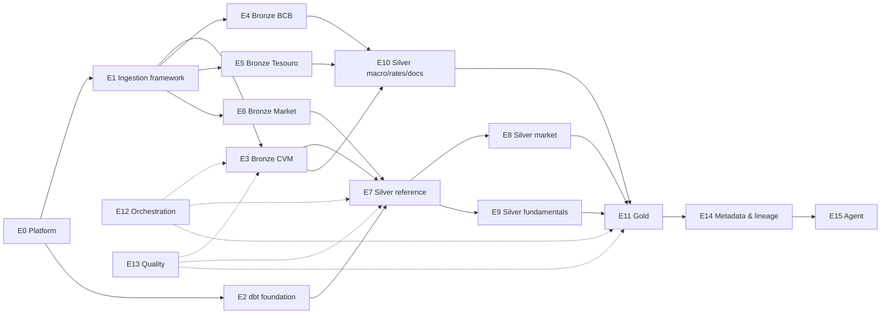

# Batch Lakehouse — Epics

Delivery plan for the batch lakehouse described in [PRD.md](PRD.md) and [ARCHITECTURE.md](ARCHITECTURE.md).
Scope is **V1**: four source families (CVM, BCB, Tesouro, market data), Bronze → Silver → Gold, orchestration, quality, metadata, and the agent.
IBGE, company IR, news, derivatives, funds and international data are V2+ and not covered here.

## Status at a glance

| # | Epic | Layer | Size | Depends on | Status |
|---|---|---|---|---|---|
| E0 | Platform stack | infra | M | — | ✅ Done |
| E1 | Ingestion framework | bronze | L | E0 | ⬜ |
| E2 | dbt foundation | silver/gold | M | E0 | ⬜ |
| E3 | Bronze — CVM | bronze | L | E1 | ⬜ |
| E4 | Bronze — BCB | bronze | M | E1 | ⬜ |
| E5 | Bronze — Tesouro | bronze | S | E1 | ⬜ |
| E6 | Bronze — Market data (B3) | bronze | M | E1 | ⬜ |
| E7 | Silver — Reference entities | silver | M | E2, E3, E6 | ⬜ |
| E8 | Silver — Market | silver | M | E7 | ⬜ |
| E9 | Silver — Fundamentals | silver | L | E7 | ⬜ |
| E10 | Silver — Macro, rates & documents | silver | M | E2, E3, E4, E5 | ⬜ |
| E11 | Gold — Analytical products | gold | L | E8, E9, E10 | ⬜ |
| E12 | Orchestration | cross-cutting | M | E1, E2 (grows with each layer) | ⬜ |
| E13 | Data quality & contracts | cross-cutting | M | E2 (grows with each layer) | ⬜ |
| E14 | Metadata & lineage | cross-cutting | M | E11, E12 | ⬜ |
| E15 | Analytics agent | consumption | L | E11, E14 | ⬜ |
| E16 | Open-source readiness | project | M | E0 (finishes last) | ⬜ |

Sizes are relative (S ≈ days, M ≈ 1–2 weeks, L ≈ 2–4 weeks for one person).

## Dependency graph

## Milestones

| Milestone | Epics | Outcome |
|---|---|---|
| **M1 — Foundations** | E1, E2 | A source can land in Bronze, and dbt can build against both profiles. |
| **M2 — Bronze complete** | E3–E6, E12 (ingestion DAGs), E13 (Bronze tests) | All four V1 source families land daily with history backfilled. |
| **M3 — Silver complete** | E7–E10, E13 (Silver tests) | The canonical financial model exists and is tested. |
| **M4 — Gold complete** | E11, E12 (end-to-end DAG), E13 (Gold invariants) | `company_daily` answers real questions, point-in-time correct. |
| **M5 — Discoverable & conversational** | E14, E15 | Lineage and glossary are in OpenMetadata; the agent answers grounded questions. |
| **M6 — Public release** | E16 | A newcomer can clone, run lite mode and build the lakehouse from fixtures. |

---

## E0 — Platform stack ✅

**Goal:** One `docker compose` command brings up the whole platform in a lite or full profile.

**Delivered:** `docker-compose.yml` with Postgres 17, Airflow 3.3.2 (LocalExecutor, DuckDB, PyIceberg, dbt in its own venv), RustFS, Polaris 1.8.0 with a `lakehouse` catalog and `bronze`/`silver`/`gold` namespaces, and OpenMetadata 2.0.5. The `platform_smoke` DAG verifies DuckLake, Iceberg write/read and OpenMetadata.

**Carry-over (pick up in E16):**
- The lite profile hasn't been tested on its own; the skip paths in `platform_smoke` haven't run.
- Polaris hands out `http://rustfs:9000`, so host-side engines need a hosts entry or their own S3 secret.

---

## E1 — Ingestion framework

**Goal:** A small Python package that every source connector uses, so each source only defines *what* to fetch and *how* to parse it.

**Scope**
- Package layout (`ingestion/`) installable in the Airflow image, with a `Source` / `Dataset` connector interface: `discover()` → `fetch()` → `parse()`.
- HTTP client with retries, backoff, timeouts and a polite rate limit.
- **Raw landing zone:** every downloaded file is stored as-is and immutable, keyed by `source/dataset/reference/content_hash`. This is required because CVM overwrites files in place (see E3).
- Content-hash change detection: skip unchanged files and record the skip.
- Standard Bronze metadata columns, appended by the framework rather than each connector: `_source`, `_dataset`, `_source_file`, `_source_url`, `_reference_date`, `_source_updated_at`, `_ingested_at`, `_content_hash`, `_ingestion_run_id`.
- **Profile-agnostic writer:** append to DuckLake (lite) or Iceberg via Polaris (full), selected by environment, with the same table names in both.
- `ingestion_run` audit table: run id, dataset, files seen, files new, rows written, status, error.
- Parsing helpers for the quirks found during source validation: Latin-1, `;` delimiters, CRLF, decimal commas, `dd/mm/yyyy` and `MM-DD-YYYY` dates, fixed-width layouts.
- CLI entry point (`python -m ingestion run <source> <dataset> --from --to`) so it can run outside Airflow.

**Done when**
- One reference connector (BCB SGS, the simplest) lands data through the framework in both lite and full profiles, with identical table contents.
- Re-running the same window writes no duplicate rows and records the skip.
- Unit tests cover the parsing helpers and change detection.

**Risks / decisions**
- Bronze is append-only. Deduplication belongs to Silver, not the writer.
- Decide whether the raw landing zone lives in the same bucket (`s3://lakehouse/raw/`) or a separate one. The recommendation is the same bucket under a separate prefix.

---

## E2 — dbt foundation

**Goal:** One dbt project that builds the same models against DuckLake (lite) and Iceberg/Polaris (full).

**Scope**
- `dbt/` project with `profiles.yml` targets `lite` (DuckDB + DuckLake attach) and `full` (DuckDB + Iceberg REST attach to Polaris).
- **Spike first:** confirm that dbt-duckdb can materialize tables *into* an attached Iceberg REST catalog (create, replace, incremental). If it can't, define the fallback, for example materializing in DuckDB and publishing to Iceberg in a post-hook.
- Layer folders and naming conventions (`stg_<source>__<dataset>`, `silver.<entity>`, `gold.<product>`), schema routing to the `bronze` / `silver` / `gold` namespaces.
- `sources.yml` covering all Bronze tables, with freshness thresholds.
- Shared macros: point-in-time filter (`as_of`), latest-revision selection, surrogate keys.
- Seeds folder for reference mappings (SGS series registry, CVM account → metric map).

**Done when**
- `dbt build --target lite` and `dbt build --target full` both succeed on one trivial staging model.
- The spike result is written up as an ADR.

---

## E3 — Bronze: CVM

**Goal:** All V1 CVM datasets land in Bronze with full history and a complete revision trail.

**Scope**
- Datasets: `cad_cia_aberta` (company register), DFP (2010+), ITR (2011+), FCA (2010+), FRE (2010+), IPE (2003+).
- One Bronze table per CSV inside each zip (for example `bronze.cvm_dfp_dre_con`, `bronze.cvm_dfp_index`), kept CVM-shaped.
- **Revision capture:** CVM statement files hold only the latest `VERSAO`, while the index file lists all versions. Snapshot every zip on every run via the E1 landing zone, so earlier versions survive after CVM overwrites them.
- Change detection from the directory listing's last-modified date plus content hash; re-download only changed years.
- Historical backfill job, then daily incremental runs for the current and previous year.

**Done when**
- All years are backfilled, row counts reconcile against the source files, and a re-run is a no-op.
- For a filing known to have `VERSAO > 1`, Bronze contains the rows the source showed at each ingestion.

**Risks / decisions**
- Bronze can only preserve revisions from the day ingestion starts. Earlier revisions are lost upstream. Document this limitation.
- The register is not unique by CNPJ (about 140 CNPJs repeat). Keep every row in Bronze and resolve this in E7.
- The FRE zips are large (several MB per year, with many inner files). Decide which FRE sub-files V1 actually needs.

---

## E4 — Bronze: BCB

**Goal:** Macro series, FX and market expectations land in Bronze from BCB's official APIs.

**Scope**
- **SGS:** a seed-driven series registry (series id, name, frequency, unit). Start with SELIC (11, 432), IPCA (433), IBC-Br (24364), total credit (20539) and USD (1). Split daily-series backfills into windows of 10 years or less, the API's hard limit.
- **PTAX:** all 10 available currencies, closing bulletin only (`tipoBoletim = 'Fechamento'`); request dates in `MM-DD-YYYY`.
- **Focus / Expectativas:** annual, monthly, SELIC-by-meeting and 12-month inflation entity sets. Keep both `baseCalculo` values (0 = 30-day respondent window, 1 = 5-day).
- Incremental windows: re-fetch a trailing window (for example 30 days) to pick up revisions, relying on E1 change detection.

**Done when**
- All registry series are backfilled from their first observation.
- Adding a series is a seed-row change, not new code.
- USD from SGS 1 equals PTAX USD closing for overlapping dates (this already matched during source validation).

**Risks / decisions**
- SGS has no publication timestamp, so `_ingested_at` becomes the knowledge time.
- Series 432 has rows dated in the future (the SELIC target until the next Copom meeting). Keep them in Bronze; downstream point-in-time filtering handles them.

---

## E5 — Bronze: Tesouro

**Goal:** Daily Tesouro Direto prices and yields land in Bronze.

**Scope**
- Resolve the CSV URL through the CKAN `package_show` API rather than hard-coding the resource id.
- The source publishes only a full file (about 14.6 MB, 177k rows). Download it daily, and append only the rows that are new or changed, compared on the natural key (`Tipo Titulo`, `Data Vencimento`, `Data Base`).
- Parse decimal commas and `dd/mm/yyyy` dates.

**Done when**
- History starts at 2004-12-31 (not 2002 as the PRD states; correct the PRD).
- A daily run appends only the latest business day.

---

## E6 — Bronze: Market data (B3)

**Goal:** Daily equity prices and the instrument master land in Bronze behind a provider boundary that UP2DATA can replace later.

**Scope**
- **COTAHIST:** annual zips for history (from the earliest year needed) and daily zips for increments. Parse the fixed-width layout (header `00`, quote records `01`, trailer `99`).
- **Instruments:** `InstrumentsConsolidatedFile` from `arquivos.b3.com.br` via the two-step token download. It provides ticker → ISIN → asset → segment.
- **IBOV composition** (optional for V1): the portfolio endpoint, for index membership.
- Provider abstraction: Bronze tables are named by provider (`bronze.b3_cotahist`), and Silver (E8) is the only layer that knows how to map each provider.

**Done when**
- Five or more years of COTAHIST are backfilled for the equity market (`TPMERC = 010`).
- PETR3 and PETR4 prices for a sample date match B3's published closing prices.

**Risks / decisions**
- **Corporate actions:** COTAHIST is unadjusted, and an adjusted close needs dividends, splits and bonus issues. Run a spike on free sources (B3 listed-company corporate events, CVM IPE notices) before E8.
- Licensing: COTAHIST and the instruments file are public downloads. Record the terms of use in the README.

---

## E7 — Silver: Reference entities

**Goal:** The canonical `company`, `security` and `trading_calendar` that every other model joins through.

**Scope**
- `silver.company`: SCD2 built from the CVM register and FCA. **Decide the business key:** CVM code (`CD_CVM`) is the recommendation, since CNPJ isn't unique in the register. Carry `cnpj` as an attribute.
- `silver.security`: built from the B3 instrument master. Link security to company via CNPJ/issuer and ISIN. Keep ticker history (ticker changes, delistings).
- `silver.trading_calendar`: B3 trading days, derived from COTAHIST dates plus a holiday seed for future dates.
- Fuzzy-match fallback and a manual override seed for company ↔ security links that can't be resolved automatically.

**Done when**
- At least 95% of active equity securities link to a company, and the unlinked rest is listed in a review table.
- PETR3 and PETR4 resolve to the same `company_id`.

---

## E8 — Silver: Market

**Goal:** Provider-independent daily prices with adjustment factors.

**Scope**
- `silver.security_price`: OHLC, volume and trade count per `security_id` and `trading_date`.
- `silver.corporate_action`: dividends, JCP (interest on equity), splits and bonus issues, from the source chosen in the E6 spike.
- Cumulative `adjustment_factor` and `adjusted_close`.

**Done when**
- Adjusted returns for a sample of tickers reconcile with an external reference within tolerance.
- Swapping the price provider requires changes only to this epic's staging models.

---

## E9 — Silver: Fundamentals

**Goal:** CVM financial statements as a long, traceable fact model.

**Scope**
- `silver.financial_statement`: one row per company, period, statement type, consolidated/individual and revision. `published_at` comes from the index file's receipt date (`DT_RECEB`); `revision` comes from `VERSAO`.
- `silver.financial_metric`: one row per account line, keeping CVM's `account_code` and `account_name`.
- Scale normalization: `ESCALA_MOEDA` is `MIL` (thousands) or `UNIDADE` (units). Store everything in units.
- Period handling: each filing carries two periods, flagged `ÚLTIMO` (current) and `PENÚLTIMO` (prior year). Keep the current period as the authoritative figure, and use the prior-year comparison only for detecting restatements.
- Normalized-metric mapping seed (`account_code` → `revenue`, `ebit`, `net_income`, `total_assets`, …), versioned and documented.

**Done when**
- Revenue, net income and equity for ten large companies match their published statements.
- Every normalized metric traces back to its CVM account codes.

**Risks / decisions**
- **Banks and insurers use different charts of accounts.** The mapping seed needs per-sector variants, or V1 limits normalized metrics to non-financial companies.
- ITR figures are year-to-date for some statements (cash flow, DVA). Flag the period type here; E11 derives the quarterly values.

---

## E10 — Silver: Macro, rates & documents

**Goal:** One schema for every macro series, plus government bonds and CVM documents.

**Scope**
- `silver.macro_series` and `silver.macro_observation`, built from SGS, PTAX and Focus, using the PRD's shared schema. Focus becomes series keyed by indicator, reference period and `baseCalculo`.
- `silver.government_bond` (bond type and maturity) and `silver.government_bond_price` (buy/sell price and yield).
- `silver.document`: IPE disclosures (company, category, date, link). This epic stores metadata and links; parsing document contents is V2.

**Done when**
- Adding a new SGS series flows to Silver with no model changes.
- IPCA in Silver matches the September 2026 value cross-checked during source validation (0.82).

---

## E11 — Gold: Analytical products

**Goal:** Question-shaped tables, with point-in-time correctness enforced.

**Scope**
- `gold.company_financials`: quarterly values derived from year-to-date ITR figures (Q4 = DFP minus nine-month ITR), trailing-twelve-month aggregates, net debt and free cash flow.
- `gold.company_ratios`: growth, margins, ROE, ROIC, net debt/EBITDA, P/E, P/B, EV/EBITDA, FCF yield and dividend yield.
- `gold.security_performance`: returns over 1d/5d/1m/1y and 20-day volatility.
- `gold.macro_daily` and `gold.rates_daily`: forward-filled onto the trading calendar, with the Tesouro curve points the PRD needs (`prefixado_1y`, the IPCA+ real rate).
- `gold.market_daily` and `gold.sector_daily`.
- `gold.company_daily`: the central projection joining all of the above.
- **Point-in-time rule:** a fundamental is visible on date D only if `published_at <= D`, and the latest revision known at D wins.

**Done when**
- A backtest-style query for a past date returns only information published by that date (enforced by a test, see E13).
- P/E and P/B for a sample of companies match an external reference within tolerance.

---

## E12 — Orchestration

**Goal:** Airflow runs everything on schedule, in dependency order, with retries and backfills. It holds no transformation logic.

**Scope**
- One ingestion DAG per source family, scheduled to each source's publication time (for example CVM refreshes around 07:00, PTAX closes around 13:00 BRT, Tesouro updates each morning).
- Airflow assets (data-aware scheduling): Bronze datasets trigger the downstream dbt builds.
- dbt run as Airflow tasks: decide between Cosmos and plain `BashOperator` (`dbt build --select`), and record the decision in an ADR.
- Backfill DAGs with parameters (`source`, `dataset`, `from`, `to`).
- Failure alerts and SLA/freshness alerts.

**Done when**
- A fresh stack backfills to the current day unattended, then stays current on schedule.
- The DAG graph mirrors the architecture: extract → load bronze → silver → test → gold → test → publish metadata.

---

## E13 — Data quality & contracts

**Goal:** Tests at every layer, including the finance-specific invariants.

**Scope**
- **Bronze:** metadata columns not null, uniqueness on `(_source_file, row)`, freshness per source.
- **Silver:** key and relationship tests (`financial_metric.company_id` → `company`), `close >= 0`, `period_end >= period_start`, one current SCD row per key.
- **Gold:** `unique(ticker, date)` on `company_daily`, plausible ranges for ROE and margins, `market_cap >= 0`.
- **Point-in-time leakage test:** no fundamental used before its `published_at`.
- **Cross-source reconciliation:** IPCA (IBGE vs SGS 433, once IBGE is added in V2) and USD (SGS 1 vs PTAX).
- **Live source contract tests:** the endpoint probes from source validation (status, schema, encoding) run on a schedule to catch upstream changes.

**Done when**
- `dbt build` fails on any contract violation, and Airflow surfaces it.
- A changed upstream schema is caught by a contract test before it breaks a model.

---

## E14 — Metadata & lineage

**Goal:** OpenMetadata explains what each table means, where it comes from and how fresh it is.

**Scope**
- Metadata ingestion runs as an Airflow task (the `publish_metadata` step). The `openmetadata-ingestion` package goes in its own venv, because OpenMetadata's bundled Airflow is disabled in this stack.
- Connectors: Iceberg/Polaris (tables and schemas), dbt (models, tests, column descriptions, lineage), Airflow (pipelines).
- Business glossary: ROE, ROIC, TTM, net debt, adjusted close, point-in-time.
- Ownership and tier tags; surface freshness and test results.

**Done when**
- In the OpenMetadata UI, `gold.company_ratios` shows lineage back to `bronze.cvm_dfp_*` and `bronze.b3_cotahist`.
- Every Gold column has a description and glossary links where relevant.

---

## E15 — Analytics agent

**Goal:** A small LangGraph agent that answers questions over Gold, grounded in metadata, with read-only access.

**Scope**
- New `agent` service in Docker Compose (full profile).
- Four tools: `search_metadata()`, `get_lineage()`, `get_table_schema()`, `execute_sql()`.
- Graph: classify intent → discover metadata → identify tables → generate SQL → SQLGlot validation (read-only, allowlisted schemas, row limit) → DuckDB over Polaris → grounded answer with the tables cited.
- No shell access, no Python execution and no writes.
- Evaluation set: 30–50 representative questions with expected SQL or answers.

**Done when**
- The agent passes an agreed share of the evaluation set.
- Every attempted write or DDL statement is rejected by validation (tested).

---

## E16 — Open-source readiness

**Goal:** A stranger can clone the repo and get value within 15 minutes.

**Scope**
- README: what the project is, a quickstart (lite mode), the full profile, and a source licensing note.
- Task runner that works on Windows, macOS and Linux (`just` or a `scripts/` folder; `make` isn't available on Windows), wrapping `dev-lite`, `dev-full`, `backfill` and `test`.
- Fixture dataset: a small slice of every source so lite mode and CI build end to end offline.
- CI (GitHub Actions): lint, unit tests, `dbt build --target lite` on fixtures, and a compose config check.
- E0 carry-over: test the lite profile on its own, and document or fix host access to RustFS.
- LICENSE, CONTRIBUTING, ADR index.

**Done when**
- On a clean machine, the quickstart reaches a populated `gold.company_daily` (on fixtures) without manual steps.
- CI is green on every pull request.

---

## Open decisions to settle early

| Decision | Needed by | Recommendation |
|---|---|---|
| Can dbt-duckdb write Iceberg tables through Polaris? | E2 | Spike first; it determines the full-profile write path. |
| Company business key | E7 | CVM code (`CD_CVM`), with CNPJ as an attribute. |
| Corporate-actions source for adjusted prices | E8 | Spike: B3 listed-company events vs CVM IPE. |
| Financial institutions in normalized metrics | E9 | Exclude from normalized metrics in V1; keep their raw accounts. |
| dbt orchestration style | E12 | Plain `dbt build --select` tasks, with Airflow assets between layers. |
| Raw landing location | E1 | Same bucket, `raw/` prefix, immutable. |
